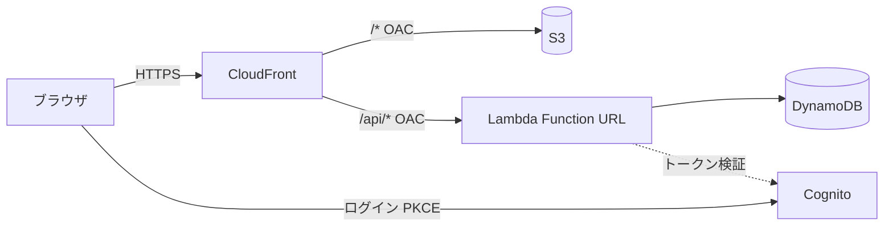

# aws-salse-sumuration

AWSソリューション提案を行う営業力実践アプリ。

JAWS-UG Sales 支部 × 彩の国埼玉支部 English LT Night（2026-11-20）の登壇
「**Developing a sales simulation application as a way to also verify cdkd's functionality**」のために作ったアプリです。

## Deal Room 〜AWS ソリューション営業 商談シミュレーター〜

**AWS のアカウントマネージャー**になって、架空の顧客と 1 件の商談を進めます。

- 顧客は 4 社（地域スーパー・製造業・SaaS スタートアップ・信用金庫）。面談相手・予算感・競合・時期の組み合わせで 216 通りの条件
- 事前調査 → 同行メンバー → ヒアリング → 課題の特定 → 提案構成 → 進め方 → 費用 → 反論 2 つ → クロージング の 10 判断
- 予算・競合・時期は **聞かないと分からない**（適切な質問・調査をしたときだけ案件シートに書き込まれる）
- 結果は「案件クローズ報告書」：受注／失注、受注確度、年間利用見込み、4 軸の評価、工程ごとのフィードバック、模範的な進め方
- 成績表（DynamoDB）に記録して競える。記録だけログインが必要（メールで自己登録）
- 「営業の基本」ページで、役割分担・BANT・TCO・責任共有モデル・共同実行計画などを解説

登場する企業・人物は架空で、採点は考え方を学ぶための簡略モデルです。AWS の公式見解ではありません。

## 登壇資料のためのドキュメント

| ファイル | 内容 |
| --- | --- |
| [docs/01-overview.md](docs/01-overview.md) | イベント・タイトル・持ち帰ってほしいこと・5 分 LT の構成案・スライドに載せる数字・ToDo |
| [docs/02-solution.md](docs/02-solution.md) | ソリューション説明（体験の流れ・シナリオ・採点・アーキテクチャ・WAF を使わない判断・費用・cdkd の検証観点） |
| [docs/03-strengths.md](docs/03-strengths.md) | 強み・こだわり・想定質問と答え |
| [docs/04-event-runbook.md](docs/04-event-runbook.md) | デプロイ手順・cdkd 検証シート・当日と終了後の手順 |
| [docs/05-lt-script-en.md](docs/05-lt-script-en.md) | 英語 LT の台本（スライド文言と読み上げ原稿） |

## アーキテクチャ



- 常時起動のサーバーなし。API Gateway も使わない
- **WAF は使わない**（イベント期間だけの公開で固定費に見合わないため。代わりに OAC・ログイン必須の保存・サーバー再計算・キャッシュで守る）
- 採点エンジン（`shared/engine.ts`）はブラウザと Lambda で共有し、保存時はサーバーが計算し直す

詳しくは [docs/02-solution.md](docs/02-solution.md) と [aidlc-docs/inception/application-design.md](aidlc-docs/inception/application-design.md)。

## ディレクトリ

| パス | 内容 |
| --- | --- |
| `shared/scenarios.ts` | シナリオ・サービス・反論などの定義と採点の重み |
| `shared/engine.ts` | 商談エンジン（条件生成・入力検証・採点・模範解答） |
| `api/handler.ts` | API（Lambda） |
| `web/` | フロントエンド（TypeScript + esbuild、フレームワークなし） |
| `lib/deal-room-stack.ts` | CDK スタック：CloudFront, S3, Lambda, DynamoDB, Cognito |
| `test/` | Vitest のテスト |
| `scripts/` | フロントのビルド、ログを残すデプロイ、採点バランスの確認 |
| `docs/` | 登壇資料のためのドキュメント |
| `aidlc-docs/` | AI-DLC の成果物（要件・設計・ユニット・テスト） |
| `.claude/`, `aidlc/` | AI-DLC のハーネスとメモリ |

## 使い方

前提：Node.js 22.12 以上、AWS 認証情報（リソースを直接作成できる権限）

```bash
npm ci
npm test              # テスト
npm run balance       # 採点バランスの確認
npm run dev           # http://localhost:8000（記録・成績表はデプロイ後）
```

### cdkd でデプロイ

[cdkd](https://github.com/go-to-k/cdkd)（CDK Direct）は CloudFormation を介さず AWS SDK を直接呼び出して CDK アプリをデプロイするツールです（開発・検証用途向け）。

```bash
export AWS_PROFILE=<profile> AWS_REGION=ap-northeast-1
aws sts get-caller-identity   # デプロイ先アカウントを確認

npx cdkd bootstrap            # 初回のみ
npm run diff                  # 変更内容の確認
npm run deploy                # フロントをビルドして cdkd でデプロイ（deploy-logs/ にログ）
npm run deploy:fast           # 安定化待ちを省略
npm run destroy               # 削除
```

| オプション（`-c key=value`） | 既定 | 内容 |
| --- | --- | --- |
| `allowLocalhost` | `false` | `true` で `http://localhost:8000` をログイン後の戻り先として許可 |
| `destroyData` | `false` | `true` でスタック削除時に記録とユーザープールも削除 |
| `stackName` | `DealRoom` | スタック名 |

通常の AWS CDK CLI でもデプロイできます（`npx cdk deploy`、要 `cdk bootstrap`）。

## 参考

- 構成・実装方針：[MASAKIOKUDA-eng/sakagura-sumirator](https://github.com/MASAKIOKUDA-eng/sakagura-sumirator)
- [AI-DLC](https://github.com/awslabs/aidlc-workflows)：成果物は [aidlc-docs/](aidlc-docs/README.md)
