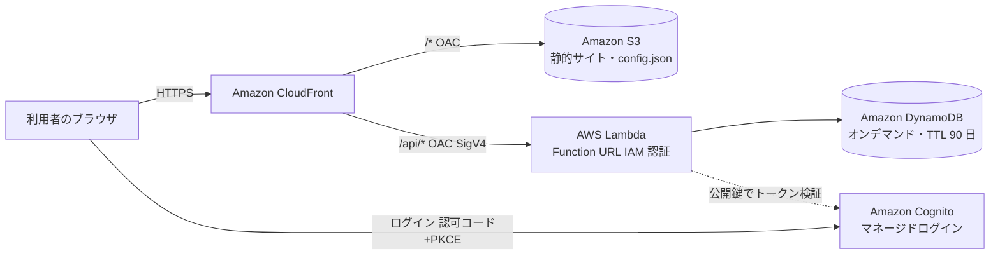

# 02. ソリューション説明

## Deal Room とは

AWS のアカウントマネージャーになって、架空の顧客と 1 件の商談を進める Web アプリです。
1 回 10 分ほどで、ヒアリングから受注・失注までを体験し、マネージャーからのフィードバックで「なぜその結果になったか」を学びます。

## 体験の流れ

| フェーズ | 判断 | 学べること |
| --- | --- | --- |
| 準備 | 事前調査（4 つから 2 つ）／同行メンバー（4 つから 2 つ） | 公開情報で投資の方向と契約の節目をつかむ。SA・スペシャリスト・パートナー・プロフェッショナルサービスの役割 |
| ヒアリング | 質問（6 つから 3 つ）／課題を 1 つに絞る | BANT の型。症状ではなく事業への影響を課題にする |
| 提案 | サービス構成（18 から 1〜5）／進め方 | 課題に必要な部品を過不足なく。PoC・段階移行・ワークショップの使い分け |
| 見積 | 費用の出し方 | オンデマンド・Savings Plans・支援策・値引きの使い分け |
| 交渉 | 反論 2 つへの対応 | 責任共有モデル・TCO・トレーニング・ロックインの考え方 |
| クロージング | 次の一歩 | 共同実行計画（Mutual Action Plan）とエグゼクティブ会議 |
| 結果 | 案件クローズ報告書 | 受注／失注、受注確度、年間利用見込み、4 軸の評価、工程ごとのフィードバック、模範的な進め方 |

## 案件（シナリオ）

| 顧客（すべて架空） | 業種 | 本当の課題 | 核になる構成 |
| --- | --- | --- | --- |
| まるやまストア | 地域スーパー＋ネットスーパー | セール時に EC が止まり売上を失う | 伸び縮みするアプリ基盤・マネージド DB・CDN |
| 東和精機 | 製造業（3 工場） | 設備データが集まらず停止の予兆をつかめない | IoT でのデータ収集・S3・分析 |
| ルクシード | SaaS スタートアップ | インフラ運用に開発者を取られ、生成 AI 機能を出せない | 生成 AI 基盤・サーバーレス・マネージド DB |
| さくら台信用金庫 | 地域金融 | 本部が被災するとデータを復旧できない | 遠隔地バックアップ・アカウント統制・脅威検知 |

案件ごとに、面談相手（技術責任者／財務責任者／経営トップ）・予算感（3 段階）・競合（なし／既存 SIer／他社クラウド）・時期（2 段階）が乱数で決まり、**216 通り**の条件になります。
予算・競合・時期は最初は「未確認」で、**適切な質問や調査をしたときだけ案件シートに書き込まれます**。聞かなければ、後の判断（費用の出し方・クロージング）を勘で決めることになります。

## 採点のしくみ

| 評価軸 | 重み | 中身 |
| --- | --- | --- |
| 顧客理解 | 25% | 事前調査・質問の選び方（条件で重要な質問が変わる）・課題の特定 |
| 提案の適合 | 30% | 必須の構成要素の充足、関係の薄いサービスの減点、進め方、同行メンバー |
| 経済性 | 20% | 費用の出し方（条件との相性）、構成の費用と予算感の比較 |
| 信頼構築 | 25% | 反論への対応 2 つ、クロージング |

- 合計点から受注確度を計算し、50% 以上で受注。競合がいるほど受注に必要な点数が上がる（競合なし 64・既存 SIer 68・他社クラウド 72 を中心にした S 字カーブ）
- 受注時の年間利用見込みは、構成の適合度と値引きの有無で変わる（値引きすると受注しやすくなるが、売上は減る）
- 全 216 条件で、最適な判断は 96〜100 点。ランダムな判断の中央値は 54〜56 点、受注率は 6〜10%（`npm run balance`）
- 採点ロジック（`shared/engine.ts`）はブラウザと Lambda で同じコード。保存時はサーバーが判断内容から計算し直すため、点数の改ざんはできない

## アーキテクチャ

| 経路 | 内容 |
| --- | --- |
| 利用者 → CloudFront | すべて HTTPS。静的ファイルはハッシュ付きの名前で 1 年キャッシュ、`index.html` は毎回確認 |
| CloudFront → S3 | S3 は非公開。OAC で CloudFront からのみ読める |
| CloudFront → Lambda | Function URL は IAM 認証。OAC が SigV4 で署名したリクエストだけを受け付ける。API Gateway は使わない |
| Lambda → DynamoDB | 単一テーブル・GSI なし。「自分の記録」用の要約を同じトランザクションで書く。記録は 90 日で自動削除 |
| 利用者 → Cognito | メールで自己登録。パスワードはアプリを通らない。記録の保存にだけログインが必要 |

### WAF を使わない判断

参考リポジトリ（酒蔵シミュレーター）では CloudFront に WAF を付けていましたが、今回は付けていません。

- 公開はイベント期間だけで、終わったら削除する。Web ACL とルールの月額固定費（数 USD〜）に見合わない
- 代わりに次の対策で守る：CloudFront 経由以外で API を呼べない（OAC + IAM 認証）／保存はログイン必須／入力はサーバーで検証し点数は再計算／一覧・成績表の応答は CloudFront で数秒〜30 秒キャッシュ（Lambda 呼び出しを減らす）／記録は TTL で自動削除
- 常設するなら、WAF（レート制限 + マネージドルール）を追加する（参考リポジトリの `lib/waf-stack.ts` と同じ形で追加できる）

### 費用の目安（イベント規模・数百アクセス）

| サービス | 目安 |
| --- | --- |
| CloudFront / Lambda / DynamoDB / S3 / Cognito（Essentials は月 1 万 MAU まで無料） | 無料利用枠内でほぼ 0 USD |
| CloudWatch Logs | 保持 1 週間。ほぼ 0 USD |
| WAF | 使わないので 0 USD |

## cdkd について

[cdkd](https://github.com/go-to-k/cdkd)（CDK Direct）は、AWS CDK アプリを CloudFormation を介さず AWS SDK で直接デプロイするツールです。
状態は cdkd の状態バケット（S3）に保存されます。cdkd 自体は開発・検証用途向けと案内されているため、本番運用には通常の `cdk deploy` を使う前提です。
このアプリは通常の AWS CDK CLI（`npx cdk deploy`）でも同じようにデプロイできます。

### このアプリで cdkd に扱わせるもの（検証観点）

| 観点 | このアプリでの該当箇所 |
| --- | --- |
| 基本リソース | DynamoDB（TTL）、S3（パブリックアクセスブロック・SSL 強制）、Lambda（arm64） |
| 依存関係の解決 | Cognito クライアントのコールバック URL が CloudFront のドメインに依存 |
| 新しめのリソース | Cognito Managed Login Branding、Lambda Function URL 向け CloudFront OAC |
| アセット | `NodejsFunction`（esbuild でバンドル）、`BucketDeployment` 用のサイト資材 |
| カスタムリソース | `BucketDeployment`（2 つ）、`autoDeleteObjects` |
| ライフサイクル | `synth` / `diff` / `deploy` / `deploy --no-wait` / `destroy` |

結果の記録は [04-event-runbook.md](04-event-runbook.md) の「cdkd 検証シート」に書き込みます。
